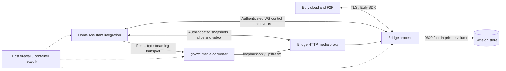
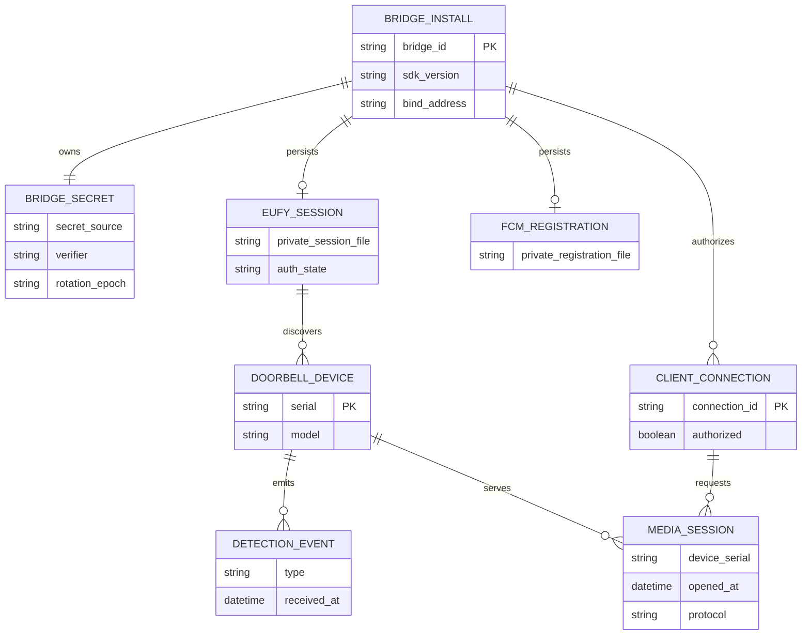
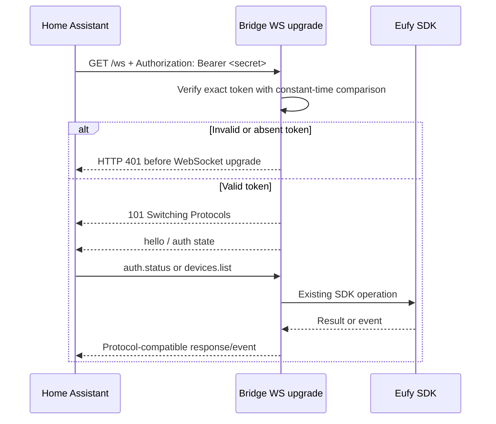
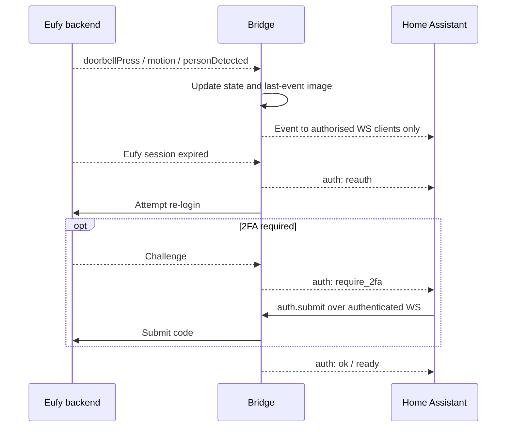

# Doorbell bridge security architecture

Status: implementation design (not a statement that controls are deployed)
Target: `dev/security-hardening` | Source baseline: `main` at `6b3ccbc09293da019e6f91db516856644501dbd2`

## 1. Objectives and boundaries

Harden the existing Eufy SDK bridge for a single doorbell account while preserving Home Assistant discovery, Eufy 2FA/captcha, doorbell press and detection events, snapshots, live video, and session recovery. No device serial allowlist is required. Avoid broad SDK rewrites and unrelated Solix changes during security implementation unless removing a reachable attack surface. Two-way audio is not newly implemented.

Threats: an untrusted LAN or cross-VLAN client reading camera media, issuing device commands, submitting 2FA/captcha, observing event metadata, or reaching go2rtc's management surface. Host-root and supply-chain compromises remain distinct risks.

Assumptions: the Home Assistant integration is updated alongside the bridge; the existing upstream integration currently calls `aiohttp.ClientSession.ws_connect(url, heartbeat=30)` without credentials. Thus authentication cannot be enforced unilaterally without breaking integration. Both bridge and frontend need coordinated release/versioning.

## 2. Trust boundaries and components



The go2rtc stream conversion must NOT bypass the media access policy. Preferred design: go2rtc's management API on loopback only; RTSP/WebRTC exposed solely to an authenticated media proxy or equivalent supported native go2rtc authentication. If supported auth cannot be confirmed, do not open those listeners to the LAN. Host networking is not the production default; bridge networking and explicit published ports require a WebRTC ICE connectivity test.

## 3. Logical ERD

This is a **logical** entity relationship diagram, not a new database schema. Records are environment variables, in-memory objects and private files.



Secrets must not appear in logs, URLs, events, health checks, generated go2rtc URLs or error responses. `/app/data` contains session material and recent thumbnails; its file ownership and directory permissions are part of the security boundary.

## 4. WebSocket authentication interaction



Auth is bridge-client authentication, distinct from the bridge's own Eufy login. The token must be presented during WS upgrade so even `auth.submit` is inaccessible to unauthorised clients. Allow a strictly controlled rolling token rotation, or document restart-based rotation; never silently permit an old unauthenticated protocol.

## 5. HTTP/media interaction

```mermaid
sequenceDiagram
  participant HA as Home Assistant
  participant API as Bridge media handler
  participant SDK as Eufy camera SDK
  participant RTC as go2rtc
  HA->>API: GET /snapshot/<serial> + bearer token
  API->>API: Authorise BEFORE camera/cache access
  alt Not authorised
    API-->>HA: 401; no image or state
  else Authorised
    API->>SDK: Read retained thumbnail or live snapshot
    SDK-->>API: JPEG
    API-->>HA: JPEG
  end
  RTC->>API: GET /stream/<serial> using scoped internal credential
  API->>API: Validate internal credential
  API->>SDK: Open P2P readable stream
  SDK-->>RTC: Camera frames via API
```

The internal go2rtc-to-bridge credential should not be the same as the Home Assistant control token. A camera request must never start P2P before authorisation. Keep `/healthz` minimal (liveness only) or authenticated; do not reveal device serials, Eufy auth state or streaming metadata anonymously.

## 6. Event and reauthentication interaction



## 7. Security invariants

1. No unauthorised client receives state, events, camera media, session challenges or device controls.
2. Missing/malformed tokens fail closed; no token in a query string, WebSocket subprotocol used as a secret, log or persisted generated stream URL.
3. Private on-disk material is owned by the container service UID; directories are not group/world readable. Host volume permissions are provisioned explicitly rather than recursively chowned on each startup.
4. go2rtc listeners cannot be reached outside their intended network boundary; unprotected direct RTSP access is not accepted as equivalent to HTTP bearer authentication.
5. Authentication changes retain compatible Eufy 2FA/captcha and reconnection semantics; existing Home Assistant installation needs explicit token setup.
6. No claims of successful runtime isolation until both local tests and a real Home Assistant + doorbell integration test pass.

## 8. Security considerations

Bearer tokens protect access only over trustworthy channels. Cross-host cleartext HTTP/WS exposes bearer credentials to network observers: deploy behind TLS termination or over a private authenticated tunnel when traffic crosses host boundaries. Requests must avoid embedding secrets in URLs. The image's go2rtc binary and npm dependencies require provenance and advisory checks separately from endpoint hardening.
